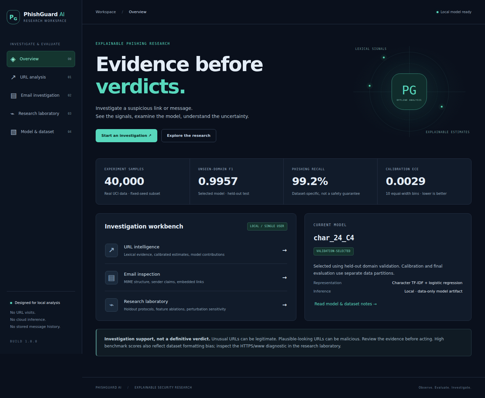
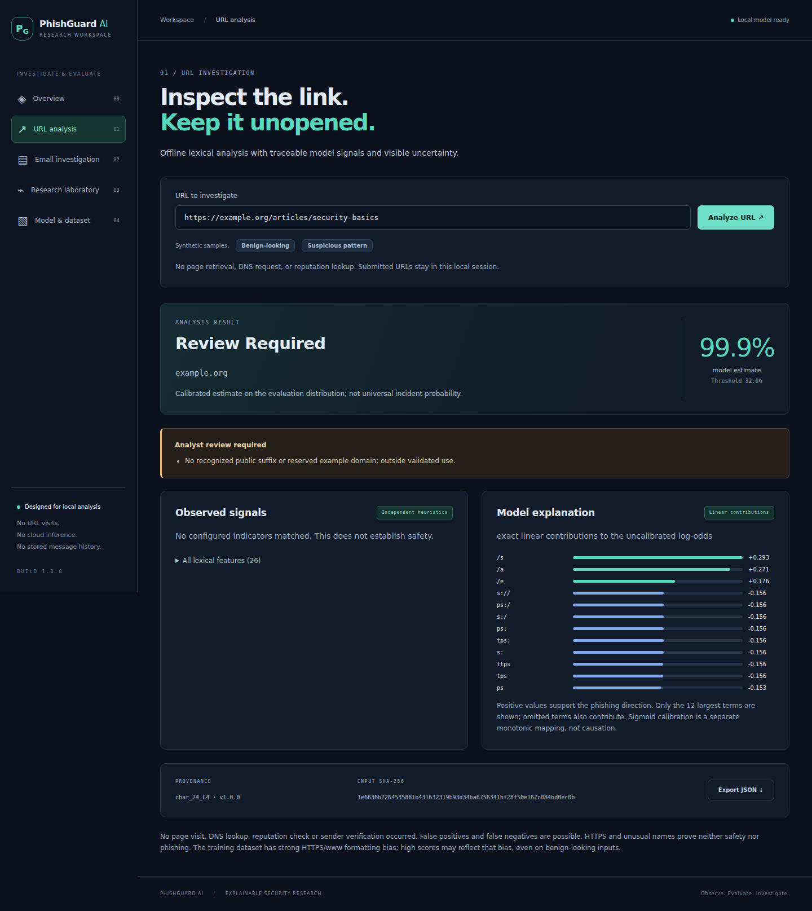
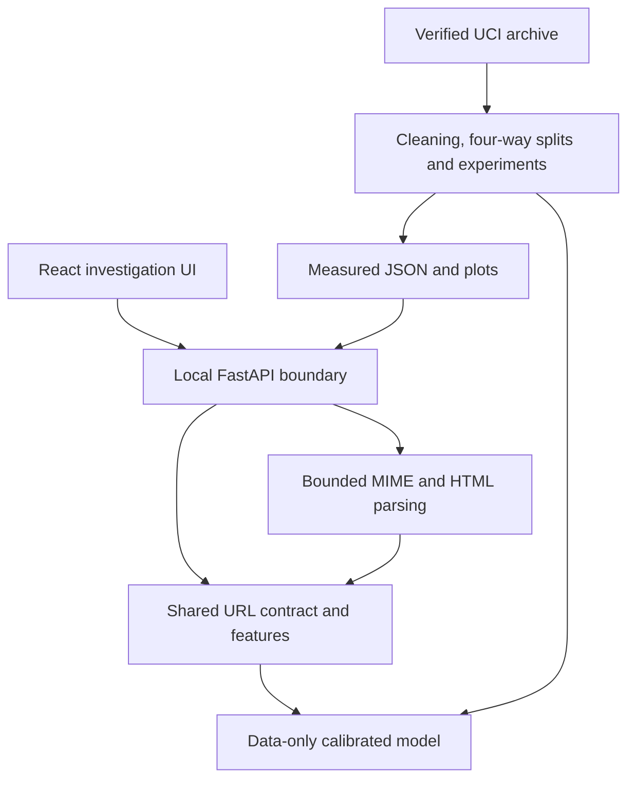

# PhishGuard AI

**Explainable Phishing Detection & Adversarial Robustness Research Platform**

Investigate URLs and emails locally, inspect model signals, and reproduce an
honest comparison of offline phishing detectors. No submitted URL is visited.

> **Research and investigation support, not a definitive phishing verdict.**
> The strong benchmark scores below reflect a single-source dataset with severe
> HTTPS/`www` formatting bias. They are not estimates of real-world protection.

An independently rebuilt and extended research-oriented implementation inspired
by an earlier team-led phishing detection prototype developed for ShellHacks 2026.
This is new code and new experimentation, not recovered hackathon source or
historical commits. No institutional endorsement is claimed.



## Research question and implemented capabilities

How reliably can offline lexical and structural URL features identify phishing,
and how do evaluation protocol, calibration and controlled perturbations affect
performance and explanations?

- Strict offline HTTP(S)/IDNA parsing and 26 independently computed features.
- Character TF-IDF logistic regression, lexical random forest and transparent rules.
- Random and registrable-domain-disjoint four-way splits; exact-duplicate checks.
- Separate sigmoid calibration, validation-only selection, two feature ablations,
  domain-cluster bootstrap intervals and seven perturbation categories.
- URL reports with model identity, review reasons, exact linear contributions and
  independent heuristic observations; JSON export through CLI or dashboard.
- Bounded email text/raw message/`.eml` inspection, safe HTML-to-text extraction,
  attachment metadata and URL inference. Authentication headers are **unverified claims**.
- Five connected React screens: overview, URL analysis, email investigation,
  research laboratory, and model/dataset documentation. No invented history.

## Quick start

Tested on Python **3.12.14**, Node **24.19.0**, Linux x86-64. Use Python 3.12 for
closest reproduction; Python 3.13+, Windows and macOS have not been validated.
The application works offline after installation. Setup and dataset acquisition
need network access. All commands below run from the extracted repository root.

```bash
python3.12 -m venv .venv
source .venv/bin/activate
python -m pip install -r requirements-lock.txt -e '.[dev]'
npm ci --prefix frontend
npm run build --prefix frontend
python -m phishguard.cli serve
```

Open **http://127.0.0.1:8000**. FastAPI serves the compiled UI and API on the same
origin. The included trained JSON model and reports make retraining optional.
On PowerShell, activate with `.venv\Scripts\Activate.ps1`.
For frontend development, run `npm run dev --prefix frontend` in a second terminal;
Vite serves port 5173 and proxies `/api` to the local backend.

## Complete demonstration

```bash
python scripts/demo.py
python -m phishguard.cli url 'https://example.org/articles/security-basics'
python -m phishguard.cli url 'http://account-verify.example.test/login/secure?user=demo'
python -m phishguard.cli email examples/message.eml
python -m phishguard.cli --help
```

Generated reports are in `reports/demo/`. In the browser, use the synthetic sample
buttons, inspect contributions, export JSON, upload `examples/message.eml`, then
open the research laboratory and switch protocols/models.

The benign-looking URL actually receives **0.999226**, while adding `www` changes
it to **0.725814**. Both return `review_required`. These are deliberately retained
failure examples, not successful detection claims. The suspicious-pattern URL
also requires review. Email output has **no email ML probability**.



## Real-data results

[UCI PhiUSIIL dataset 967](https://archive.ics.uci.edu/dataset/967/phiusil-phishing-url-dataset),
Prasad & Chandra (2024), **CC BY 4.0**. Only `URL` and `label` are used; no supplied
webpage/similarity/popularity features enter training. Original UCI `0=phishing`,
`1=legitimate`; internal `1=phishing`, `0=legitimate`.

235,795 raw rows → 234,885 cleaned → seeded **40,000**-row subset, including 17,036
phishing labels and 35,641 domain groups. Removed: 9 malformed rows, 899 duplicate
rows, and both rows of a contradictory-label group. See the
[dataset card](docs/dataset-card.md) for exact hashes and attribution.

| Protocol / model | Precision | Recall | F1 | FPR | Brier |
|---|---:|---:|---:|---:|---:|
| Random / character LR | 0.9994 | 0.9918 | 0.9956 | 0.0004 | 0.0038 |
| Domain-disjoint / character LR | 0.9991 | 0.9923 | 0.9957 | 0.0006 | 0.0038 |
| Domain-disjoint / lexical forest | 0.9919 | 0.9824 | 0.9871 | 0.0056 | 0.0084 |
| Domain-disjoint / forest without host family | 0.9864 | 0.9191 | 0.9516 | 0.0088 | 0.0303 |
| Domain-disjoint / forest without HTTPS | 0.9175 | 0.9105 | 0.9140 | 0.0571 | 0.0595 |
| Domain-disjoint / fixed rules | 1.0000 | 0.0123 | 0.0244 | 0.0000 | — |

The deployed `char_24_C4` won **validation** F1, not test F1. Its group test contains
7,879 rows and 7,129 domain groups; confusion matrix `[[4637,3],[25,3214]]` (actual
rows, predicted columns; legitimate then phishing). Threshold 0.32. Cluster
bootstrap F1 interval: 0.9941–0.9973, conditional on this single fit and split.

Random and group F1 are almost equal; this experiment does **not** demonstrate a
large generalization drop. All legitimate training examples have HTTPS and `www`.
Domain separation cannot remove that collection artifact. The fixed rules are
conservative and have extremely poor recall; this is not a comparison against a
tuned industrial detector. See [results](docs/results.md),
[error analysis](docs/error-analysis.md), and the [technical report](docs/technical-report.md).

## Architecture and dependencies



`src/phishguard/` contains parsing, features, inference, services, API and CLI;
`research/` contains acquisition, partitioning, learners, evaluation and plots.
`frontend/` holds the React application; `tests/`, `scripts/`, `docs/`, `models/`
and `reports/` contain validation, reproducibility tools and reviewable artifacts.

FastAPI/Pydantic provide HTTP validation; sklearn/NumPy/SciPy/pandas implement ML;
tldextract supplies a bundled offline public-suffix list; idna handles hostnames;
Matplotlib creates scientific figures. The CLI uses standard-library argparse.
Email parsing uses the standard library. React/Vite provide the UI; SVG charts
avoid a charting dependency. Pytest/Ruff and Vitest/Playwright/Prettier are development
and validation dependencies. Python versions are captured in `requirements-lock.txt`;
Node dependencies and integrity hashes are in `frontend/package-lock.json`.

## Reproduce the research

```bash
python -m phishguard.cli acquire
python -m phishguard.cli research --samples 40000 --seed 2026 --output reports/runs/reproduction
python scripts/smoke_research.py --output reports/runs/synthetic-smoke
```

Choose a **new output directory** for each experiment. Outputs include
`research.json`, `split-manifest.json`, `model.json`, `model.sha256` and `figures/`.
The archive downloader verifies the documented SHA-256; it never opens its sample
URLs. Full runs use real UCI data; the synthetic smoke only checks pipeline behavior.
Two real-data runs produced identical sample/split manifests and selected model
bytes; forest ranking metrics differed by at most 1.18e-7. Bitwise reproducibility
of all forest metrics is not claimed. Details: [methodology](docs/experimental-methodology.md).

To install your reviewed new run, copy `model.json` and `model.sha256` into `models/`,
`research.json` and `split-manifest.json` into `reports/`, and generated plots into
`reports/figures/`; restart the server. Keep model and report from the same run.

## Tests and genuine screenshots

```bash
python -m pytest -q
ruff check src tests scripts
ruff format --check src tests scripts
npm run format:check --prefix frontend
npm run test --prefix frontend
npm run build --prefix frontend
(cd frontend && npx playwright install chromium)
python scripts/validate.py
```

`validate.py` runs the integrated local checks, starts a real API for Playwright,
regenerates screenshots and records actual command outputs in `reports/validation/`.
See [validation](docs/validation.md) for outcomes and limitations. GitHub Actions is
configured; **hosted CI has not run because the repository has not been published**.
No coverage percentage is claimed.

[Screenshots](docs/screenshots/): [email](docs/screenshots/email-investigation.png),
[research](docs/screenshots/research.png), [mobile](docs/screenshots/mobile.png).
These are browser captures of this application, not generated mockups.

Source code: MIT License. Dataset attribution: CC BY 4.0. See [LICENSE](LICENSE) for details.

For reproducibility, see the [technical report](technical-report.md), [validation results](validation.md), and [research limitations](limitations.md). Automated checks are available under GitHub Actions.
