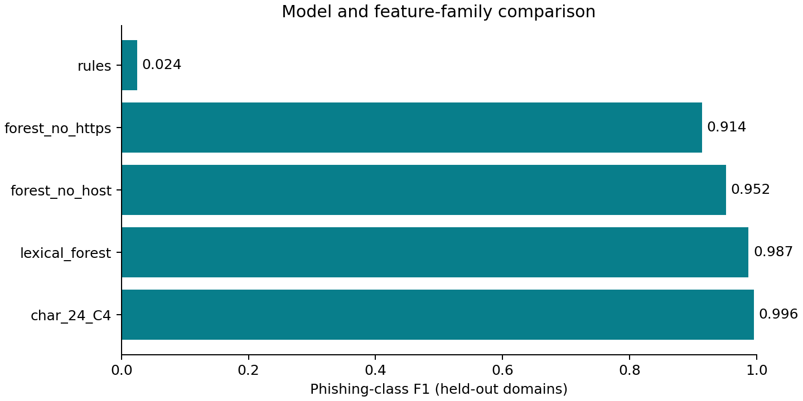
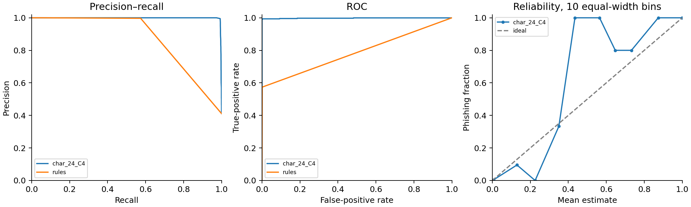

# Measured results

Source of every number: `reports/research.json` and `reports/api-benchmark.json`.

## Detection and calibration

| Protocol | Model | Precision | Recall | F1 | FPR | ROC-AUC | AP | Brier | ECE |
|---|---|---:|---:|---:|---:|---:|---:|---:|---:|
| random | char_24_C4 | 0.999408 | 0.991782 | 0.995580 | 0.000435 | 0.997520 | 0.998137 | 0.003753 | 0.002046 |
| random | lexical_forest | 0.994625 | 0.977693 | 0.986086 | 0.003919 | 0.995069 | 0.996358 | 0.009384 | 0.002287 |
| random | rules | 1.000000 | 0.008218 | 0.016303 | 0.000000 | 0.775367 | 0.740883 | — | — |
| domain_disjoint | char_24_C4 | 0.999067 | 0.992282 | 0.995663 | 0.000647 | 0.997941 | 0.998231 | 0.003782 | 0.002889 |
| domain_disjoint | lexical_forest | 0.991895 | 0.982402 | 0.987126 | 0.005603 | 0.996335 | 0.996708 | 0.008417 | 0.003721 |
| domain_disjoint | forest_no_host | 0.986415 | 0.919111 | 0.951574 | 0.008836 | 0.985190 | 0.985997 | 0.030303 | 0.009276 |
| domain_disjoint | forest_no_https | 0.917548 | 0.910466 | 0.913993 | 0.057112 | 0.971451 | 0.968831 | 0.059470 | 0.022767 |
| domain_disjoint | rules | 1.000000 | 0.012349 | 0.024398 | 0.000000 | 0.786361 | 0.747425 | — | — |

AP means average precision, not trapezoidal PR area. The fixed rule index is not
a probability, so Brier/ECE are not reported for it. Thresholds differ by model
and are chosen on validation; see the complete JSON for validation search.

The group-selected character model made 3 false positives and 25 false negatives.
Its 95% domain-cluster F1 interval is 0.994125–0.997310, conditional on one fit.
Random versus group F1 differs by only 0.000083. No large group-generalization
penalty was observed. Source formatting bias survives domain separation.

## Calibration and ablations

| Group model | Raw Brier | Calibrated Brier | Raw ECE | Calibrated ECE |
|---|---:|---:|---:|---:|
| char_24_C4 | 0.005122 | 0.003782 | 0.015081 | 0.002889 |
| lexical_forest | 0.008432 | 0.008417 | 0.004724 | 0.003721 |
| forest_no_host | 0.029801 | 0.030303 | 0.002950 | 0.009276 |
| forest_no_https | 0.063392 | 0.059470 | 0.060048 | 0.022767 |

Calibration improves the selected model's Brier and ECE; it slightly worsens
Brier for the no-host ablation. Monotone calibration preserves score ordering,
apart from numerical ties; changing thresholds can change decisions.
Removing host features lowers forest F1 by 0.035552; removing HTTPS lowers it
by 0.073132. Proxy features remain, so these are controlled feature removals,
not causal proof. Some reliability bins contain only 3–6 cases.

## Engineering measurements

Full second experiment: **90.78 s**, including cleaning, search, evaluation and perturbations (plot creation follows).
Selected estimator fit: **2.904 s**; artifact: **1,518,577 bytes**.
Portable model, 60 warm single predictions: mean **0.305 ms**, median **0.256 ms**, p95 **0.533 ms**.
One 1,000-URL normalized batch: **21,206 URLs/s**. This excludes HTTP, report generation and explanations.

| Actual loopback API input | Requests after 3 warmups | Mean ms | Median ms | p95 ms |
|---|---:|---:|---:|---:|
| url | 30 | 3.532 | 3.228 | 5.057 |
| email_text | 30 | 6.900 | 6.588 | 9.264 |
| email_upload | 30 | 6.875 | 5.991 | 9.350 |

Environment: Python 3.12.14, Linux x86-64, 9 reported logical CPUs in a shared
container. Physical CPU model, exclusive CPU allocation and memory quota were
not established. API measurements are sequential warm loopback requests, not
load tests. Timings vary with scheduling and are not production guarantees.
Scientific library versions are recorded in the experiment JSON; the clean
validation environment is pinned in `requirements-lock.txt`. The study used
Matplotlib 3.11.2 for its original plots; deliverable plots are regenerated with
the pinned 3.10.8. This changes rendering, not predictions or metrics.
