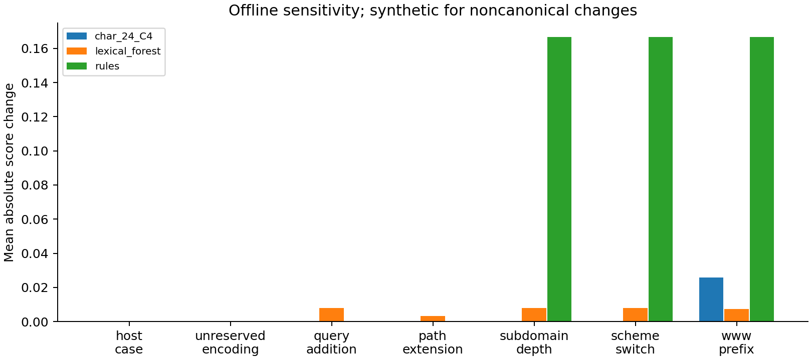

# Controlled robustness study

The first five categories were specified before result inspection. Scheme switching
and www prefixing are **post-hoc exploratory diagnostics** added after observing
formatting bias. No hyperparameters, decision thresholds or model choices changed.

Host/scheme casing and unreserved path percent encoding use the first 400 group-test
URLs in deterministic split order. Userinfo and path case are preserved. Their
canonical representations are identical; a zero score change is expected by design,
not evidence of general adversarial robustness. Some URLs have no eligible character.

Other categories use 60 synthetic URLs (30 docs-like HTTPS and 30 suspicious-pattern
HTTP strings) under reserved `.test` domains. They have no independently established
labels. Query/path, host and scheme changes can change semantics or destination.
Nothing is visited, registered, delivered or tested as an actual attack.

| Category | Model | Pairs | Mean absolute score delta | Max delta | Binary flip rate |
|---|---|---:|---:|---:|---:|
| host_case | char_24_C4 | 400 | 0 | 0 | 0.0000 |
| host_case | lexical_forest | 400 | 2.49366e-19 | 1.73472e-17 | 0.0000 |
| host_case | rules | 400 | 0 | 0 | 0.0000 |
| unreserved_encoding | char_24_C4 | 400 | 0 | 0 | 0.0000 |
| unreserved_encoding | lexical_forest | 400 | 6.20164e-19 | 1.11022e-16 | 0.0000 |
| unreserved_encoding | rules | 400 | 0 | 0 | 0.0000 |
| query_addition | char_24_C4 | 60 | 3.20809e-06 | 7.02459e-06 | 0.0000 |
| query_addition | lexical_forest | 60 | 0.00807385 | 0.0295701 | 0.0000 |
| query_addition | rules | 60 | 0 | 0 | 0.0000 |
| path_extension | char_24_C4 | 60 | 8.57204e-06 | 2.80379e-05 | 0.0000 |
| path_extension | lexical_forest | 60 | 0.00319314 | 0.00731723 | 0.0000 |
| path_extension | rules | 60 | 0 | 0 | 0.0000 |
| subdomain_depth | char_24_C4 | 60 | 0.000119908 | 0.000325973 | 0.0000 |
| subdomain_depth | lexical_forest | 60 | 0.00810918 | 0.0295701 | 0.0000 |
| subdomain_depth | rules | 60 | 0.166667 | 0.166667 | 0.5000 |
| scheme_switch (exploratory) | char_24_C4 | 60 | 6.50587e-05 | 0.000162988 | 0.0000 |
| scheme_switch (exploratory) | lexical_forest | 60 | 0.00810918 | 0.0295701 | 0.0000 |
| scheme_switch (exploratory) | rules | 60 | 0.166667 | 0.166667 | 0.0000 |
| www_prefix (exploratory) | char_24_C4 | 60 | 0.0259646 | 0.0867084 | 0.0000 |
| www_prefix (exploratory) | lexical_forest | 60 | 0.00724407 | 0.0252445 | 0.0000 |
| www_prefix (exploratory) | rules | 60 | 0.166667 | 0.166667 | 0.5000 |

Learned-model decisions did not flip in this small synthetic suite. Most starting
scores were near saturation, including docs-like fixtures: apparent stability can
therefore coexist with poor transfer. The www prefix changes character scores by
0.025965 on average; its largest change is approximately 0.0867. Rules flip on half
the subdomain-depth and www-prefix fixtures because the fixed depth indicator crosses
its threshold. This is sensitivity of a rule, not verified exploitation.

JSON also records review-band rates before/after, finding-set changes and actual
defanged paired examples. Those review rates count only distance <=0.10 from the
decision threshold; the application additionally reviews reserved domains, so all
these synthetic application inputs require review. Model/rule score units differ.
No model rankings or real-world attack-success rates follow from this experiment.
